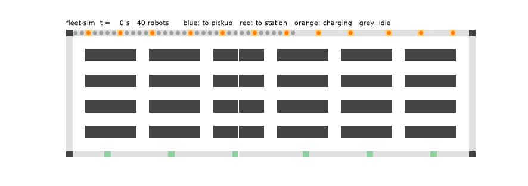
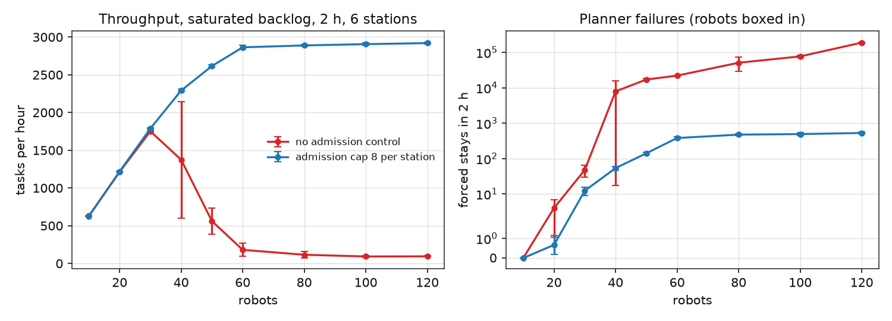
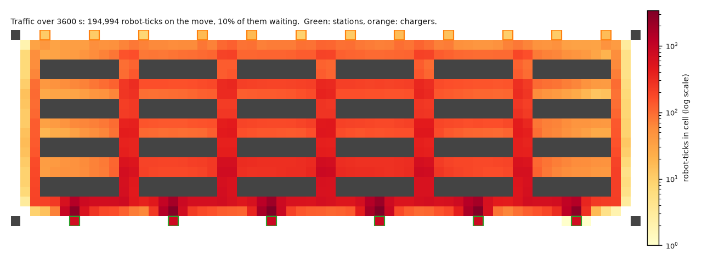
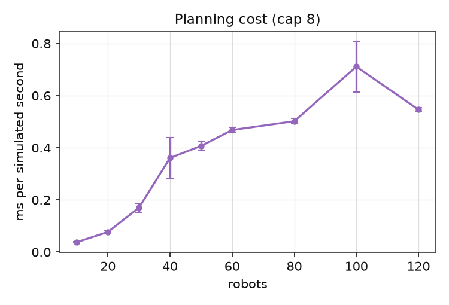
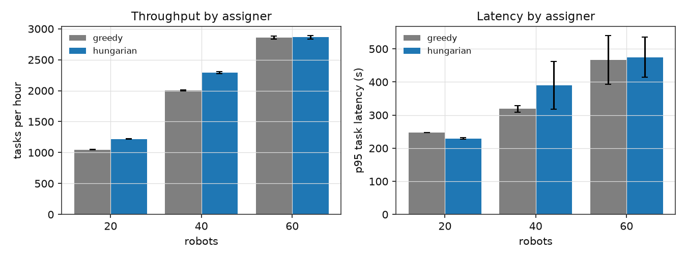
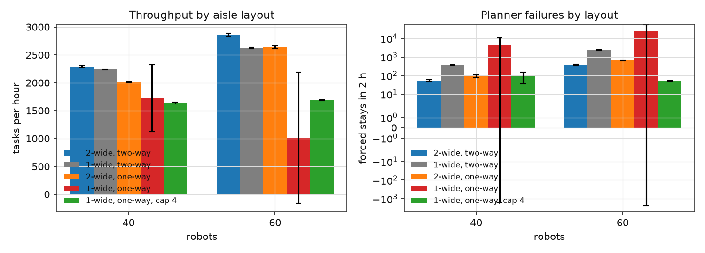
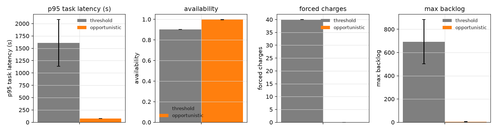
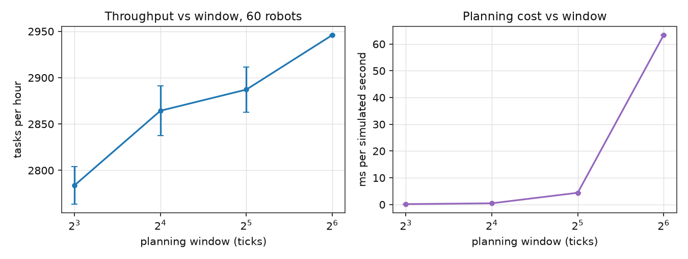
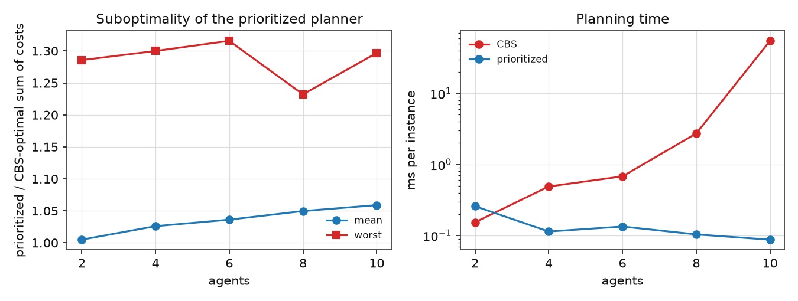
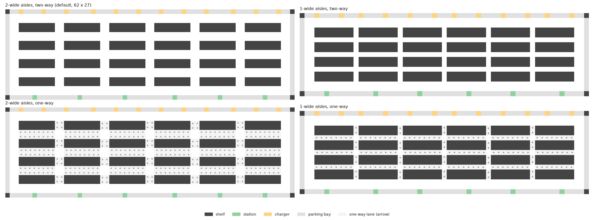

# fleet-sim

A warehouse robot fleet controller and simulator in Java 17: task assignment, cooperative
path planning on a grid with one-way lanes, station admission control, charging policies, and
an independent Python checker that re-verifies every execution log. No frameworks; the only
dependency is JUnit 5.



Blue robots drive to a pickup beside a shelf, red robots deliver to a station at the bottom,
orange robots charge at the top, grey robots are parked. One tick is one second and one cell is
one metre; a robot moves one cell per tick.

## Results

Every number below comes from `results/summary.csv`, produced by `scripts/run_experiments.sh`
(3 seeds per configuration, mean ± standard deviation, 2-hour runs of 7,200 ticks on the
default floor unless stated) and `scripts/plots.py`. No run in `results/raw/` had a collision,
a swap or an illegal move: the simulator checks every step, and the CI re-checks logged runs
with the Python script.

### Throughput against fleet size, and why admission control exists

<picture>
  <source media="(prefers-color-scheme: dark)" srcset="docs/figures/fleet-dark.png">
  
</picture>

| robots | 10 | 20 | 30 | 40 | 50 | 60 | 80 | 100 | 120 |
|---|---|---|---|---|---|---|---|---|---|
| tasks/h, cap 8 per station | 626 | 1,218 | 1,788 | 2,292 | 2,616 | 2,864 | 2,889 | 2,906 | 2,920 |
| tasks/h, no admission control | 628 | 1,213 | 1,751 | 1,375 ± 773 | 562 ± 173 | 180 ± 88 | 115 ± 43 | 92 ± 15 | 94 ± 8 |
| forced stays in 2 h, cap 8 | 0 | 1 | 12 | 54 | 141 | 381 | 474 | 492 | 528 |
| forced stays, no admission control | 0 | 4 | 48 | 7,893 | 17,081 | 22,008 | 50,903 | 76,946 | 188,114 |

With a saturated backlog and six stations the floor saturates at about 2,900 tasks per hour,
which is reached at 60 robots; the next 60 robots add 2%. Without admission control the
fleet converges on the station corridor and gridlocks: at 40 robots one seed in three
collapses, from 50 robots every seed does, and throughput falls to below 200 tasks per hour
while the planner reports tens of thousands of boxed-in robots. With at most 8 tasks per
station in flight, surplus robots wait in bays and the forced-stay count stays below 0.1 per
tick even at 120 robots.

<picture>
  <source media="(prefers-color-scheme: dark)" srcset="docs/figures/heatmap-dark.png">
  
</picture>

Where the time goes: one hour of 60 robots with cap 8 (`--log`, then `scripts/heatmap.py`).
Through-traffic spreads evenly over the aisles and cross aisles at a few hundred robot-ticks
per cell. The hot spots are the six cells just outside the stations, with over a thousand
robot-ticks each, almost all of them waiting for the robot inside to finish. That picture is
why admission control works: it bounds exactly the crowd that those six cells can hold.

<picture>
  <source media="(prefers-color-scheme: dark)" srcset="docs/figures/scaling-dark.png">
  
</picture>

Planning cost with cap 8: 0.04 ms per simulated second at 10 robots, 0.47 ms at 60 and
0.55 ms at 120, so a two-hour shift of 120 robots simulates in 4.2 s of wall time, about
1,700 times faster than real time, on a laptop (i5-1035G1).

### Task assignment: Hungarian against greedy

<picture>
  <source media="(prefers-color-scheme: dark)" srcset="docs/figures/assigner-dark.png">
  
</picture>

| robots | 20 | 40 | 60 |
|---|---|---|---|
| tasks/h, greedy nearest | 1,047 | 2,005 | 2,858 |
| tasks/h, Hungarian multi-factor | 1,218 (+16%) | 2,292 (+14%) | 2,864 (+0%) |
| median latency, greedy / Hungarian (s) | 201 / 171 | 202 / 162 | 178 / 176 |
| p95 latency, greedy / Hungarian (s) | 247 / 230 | 319 ± 10 / 390 ± 72 | 467 ± 73 / 475 ± 61 |

Matching gives 14-16% more throughput while robots are the bottleneck, and nothing once the
stations are. The median task gets faster, but at 40 robots the tail gets slower: the
minimum-cost matching keeps picking nearby tasks and the age bonus of 0.1 per second does not
protect far ones enough. That weight is the obvious thing to tune next.

### Aisle width and one-way lanes

<picture>
  <source media="(prefers-color-scheme: dark)" srcset="docs/figures/layout-dark.png">
  
</picture>

| tasks/h at 40 / 60 robots | 2-wide two-way | 1-wide two-way | 2-wide one-way | 1-wide one-way | 1-wide one-way, cap 4 |
|---|---|---|---|---|---|
| throughput | 2,292 / 2,864 | 2,237 / 2,619 | 2,009 / 2,636 | 1,724 ± 604 / 1,016 ± 1,178 | 1,634 / 1,686 |
| forced stays in 2 h | 54 / 381 | 381 / 2,326 | 93 / 643 | 4,607 / 25,095 | 95 / 52 |

Narrow two-way aisles cost 2-9% and ten times more forced stays, because robots have to back
out of each other's way. One-way lanes cost 8-12% in detours on 2-wide aisles. One-way lanes
on 1-wide aisles gridlock in some seeds: nobody can reverse, so a cycle of robots each waiting
for the next is permanent, and a prioritized planner has no way to break it. A tighter
admission cap keeps that layout stable at 1,650 tasks per hour, 40% below the open layout.
Deadlock detection on one-way graphs is the natural next feature.

### Charging policy over an 8-hour shift

<picture>
  <source media="(prefers-color-scheme: dark)" srcset="docs/figures/charging-dark.png">
  
</picture>

40 robots, Poisson arrivals at 0.4 tasks per second (about 70% of capacity), 4 h of driving per
charge, 1 h to recharge, 12 chargers. Both policies complete about 11,400 tasks.

| | threshold (charge below 20%, to 90%) | opportunistic (charge whenever idle, leave above 30%) |
|---|---|---|
| median task latency | 67 s | 47 s |
| p95 task latency | 1,609 ± 474 s | 78 s |
| peak backlog | 693 ± 191 tasks | 5 tasks |
| forced charges | 40 | 0 |
| availability | 0.90 | 1.00 |

With threshold charging every robot eventually hits 20% and leaves for an hour; the first
batteries run down together, so for a while a third of the fleet is away and the backlog
climbs to 700 tasks. Opportunistic charging uses the 30% idle time to top up and never
forces a charge. The one subtlety was that a robot driving to a charger had to be
interruptible, otherwise the trips to the far edge cost more than the charging gained.

### Planning window

<picture>
  <source media="(prefers-color-scheme: dark)" srcset="docs/figures/window-dark.png">
  
</picture>

| window / replan period (ticks) | 8 / 4 | 16 / 8 | 32 / 16 | 64 / 32 (one seed, 1 h) |
|---|---|---|---|---|
| tasks/h, 60 robots | 2,784 | 2,864 | 2,887 | 2,946 |
| forced stays in 2 h | 1,506 | 381 | 84 | 50 |
| planning ms per simulated second | 0.17 | 0.47 | 4.4 | 63 |

Longer windows resolve more conflicts ahead of time but cost exponentially more; 16 ticks is
the default. An earlier version lost half its throughput at long windows because a robot that
had finished at a station could not leave through a queued robot and simply waited for the
next scheduled replan; that is now detected and forces a replan at once.

### How far from optimal is the prioritized planner?

<picture>
  <source media="(prefers-color-scheme: dark)" srcset="docs/figures/cbs-dark.png">
  
</picture>

100 random instances per size on a 24 x 16 warehouse, sum of costs, CBS time limit 5 s.

| agents | 2 | 4 | 6 | 8 | 10 |
|---|---|---|---|---|---|
| prioritized plan is optimal | 97% | 78% | 56% | 24% | 16% |
| mean cost ratio to optimal | 1.005 | 1.026 | 1.036 | 1.050 | 1.059 |
| worst ratio | 1.29 | 1.30 | 1.32 | 1.23 | 1.30 |
| CBS time per instance | 0.2 ms | 0.5 ms | 0.7 ms | 2.7 ms | 55 ms (1 timeout) |
| prioritized time per instance | 0.26 ms | 0.11 ms | 0.13 ms | 0.10 ms | 0.09 ms |

The prioritized planner gives up about 5% of optimality at 10 agents for a planning time
that does not grow with the number of conflicts, which is what makes it usable for 120
robots re-planned every 8 ticks.

## What it models

A grid floor generated from a few parameters (`WarehouseSpec`): shelf blocks two rows deep,
aisles of width 1 or 2 that can be made one-way in alternating directions, a two-cell
corridor round the edge, pick stations along the bottom edge, chargers along the top edge and
parking bays on the remaining edge cells. The default floor is 62 x 27 cells with 24 shelf
blocks, 6 stations and 12 chargers. Stations and bays are single-exit cells: a robot may enter
one only when it is the destination, and may leave only towards the corridor.

<picture>
  <source media="(prefers-color-scheme: dark)" srcset="docs/figures/layouts-dark.png">
  
</picture>

The four floors used below. Arrows mark one-way cells; crossings stay two-way so a robot can
always turn into a cross aisle.

Tasks arrive either as a Poisson stream or as a saturated backlog (there is always work).
A task is "go to a cell beside shelf X, dwell 3 s, deliver to station Y, dwell 3 s". Robots run
a state machine (idle, to pickup, picking, to drop, dropping, to charger, charging, to park,
parked) with a battery that drains per cell moved (4 h of driving per charge by default) and
recharges at a charger (1 h from empty).

Every tick the simulator does, in order:

1. **Arrivals.** New tasks join the pending queue.
2. **Transitions.** Robots that reached their goal start dwelling, finish dwelling, start
   charging, and so on.
3. **Assignment.** Idle robots and the oldest open tasks form a cost matrix and are matched.
4. **Charging and parking.** Robots with nothing to do take a charger or a parking bay.
5. **Planning.** Every `replan` ticks all robots are re-planned together; between those ticks a
   robot that just got a goal is planned on its own against the current reservations.
6. **Move.** Each robot takes one step. Before the step, the next positions are checked for
   collisions, swaps, illegal moves, untraversable cells and empty batteries. A violation
   stops the run with an exception: it is a bug, never something to average over.

## The controller

**Task assignment.** The baseline is greedy: the oldest task takes the nearest free robot. The
alternative is the Hungarian algorithm (Kuhn-Munkres, potentials form, O(n²m)) on a
multi-factor cost: distance from the robot to the pickup, plus a penalty per task already
assigned to the same station, minus a bonus for the task's age, with pairs that the robot's
battery cannot cover marked infeasible. The solver is checked against brute force on random
rectangular matrices with infeasible entries.

**Station admission control.** At most `station-cap` tasks may be assigned to one station at
a time; surplus robots wait in bays instead of in the corridor in front of the station.
Without it the fleet packs the station corridor and gridlocks at about 60 robots on the
default floor.

**Path planning.** Windowed hierarchical cooperative A* (Silver, 2005). Robots are planned one
after another in priority order against a shared space-time reservation table. The table
stores vertex reservations (robot r is in cell c at tick t) and edge reservations (r moves
c1 to c2 during t), so both collisions and swaps are excluded. Each robot plans `window`
ticks ahead with a true-distance heuristic (a breadth-first search from its goal over the
static map, cached per goal); if the goal is out of reach within the window it follows the
best partial path. Moving and waiting both cost one tick, so the state (cell, t) is settled
the first time it is reached and no node is ever reopened.

Two details took most of the debugging time, and both were found by the per-tick invariant
checks rather than by reading code:

* A robot that cannot plan at all, not even waiting in place, is made stationary for the
  window, and every higher-priority robot that had planned through its cell is evicted and
  re-planned. The stationary set only grows, so the cascade terminates. The same eviction is
  needed when a single robot is re-planned between full replans; the first version reserved
  its stay silently and produced a collision at tick 1863 of a 100-robot run.
* A robot leaving a single-exit bay outranks everyone else. Otherwise a robot that has just
  delivered at a station and the robot queued at the station's only exit wait for each
  other forever.

**Charging.** *Threshold*: charge only below 20%, up to 90%, then vacate the charger.
*Opportunistic*: an idle robot takes any free charger, and leaves it as soon as a task appears
and the battery is above 30%; a robot below 20% must charge first. Chargers and parking bays
are single-occupancy cells a robot claims before driving there.

**Optimal baseline.** Conflict-based search (Sharon et al., 2015) is implemented to measure
how far the prioritized planner is from optimal on small instances. CBS is exponential in
the number of conflicts, so it is a reference, not a production planner here.

## Verification

* `mvn test`: 41 JUnit tests. Brute-force checks for the Hungarian solver and the hash map,
  hand-built planner scenarios (head-on in a corridor with a pocket, a goal that is reserved
  later, a boxed-in robot, eviction after a forced stay), random-instance properties for the
  cooperative planner and CBS (conflict-free, never better than optimal), and simulator runs
  across assigners, policies, random layouts and a crowded 100-robot regression case.
* The simulator checks every move of every robot during every run.
* `scripts/check_log.py` reads the CSV logs a run writes with `--log` and re-checks, without
  any simulator code, that positions are unique per tick, every move is a legal step on the
  map including one-way lanes and bay exits, no two robots swap cells, batteries never go
  negative or rise outside a charger, and every completed task was assigned once, picked up by
  its robot at its pickup cell and dropped by the same robot at a station, in that order.
* CI (`.github/workflows/ci.yml`) builds, runs the tests, runs two logged simulations and the
  Python checker on both, and a small CBS benchmark.

## Running it

```sh
mvn -B package                                   # needs JDK 17
java -jar target/fleet-sim-0.1.0.jar --help
java -jar target/fleet-sim-0.1.0.jar --robots 60 --ticks 7200 --out run.json
java -jar target/fleet-sim-0.1.0.jar --robots 40 --ticks 600 --log log --print-map > map.txt
python3 scripts/check_log.py log map.txt
java -cp target/fleet-sim-0.1.0.jar io.github.byteb8.fleetsim.cli.CbsBench --instances 50 --agents 2,4,6,8
scripts/run_experiments.sh && python3 scripts/plots.py   # every number in this README
python3 scripts/heatmap.py log map.txt docs/figures/heatmap  # traffic heat map of a logged run
```

`--print-map` shows the floor: `#` shelf, `.` free, `S` station, `C` charger, `P` parking bay,
`> < ^ v` one-way cells. `--map FILE` runs on a hand-drawn floor in the same notation.

## Layout of the code

```
src/main/java/io/github/byteb8/fleetsim/
  grid/      Dir, GridMap (cell types, one-way masks), WarehouseSpec, Layouts, DistanceField
  planning/  LongIntMap (open addressing, backward-shift delete), ReservationTable,
             SpaceTimeAStar, CooperativePlanner (WHCA* + eviction cascade), Cbs
  assign/    Assigner, GreedyAssigner, HungarianAssigner
  sim/       SimConfig, Simulator, Robot, RobotState, Task, Bays, ChargingPolicy, Metrics, EventLog
  cli/       Main, CbsBench
scripts/     check_log.py, run_experiments.sh, plots.py, animate.py, heatmap.py, draw_map.py
results/     raw/ (one JSON per run), summary.csv
```

## Limitations

* Unit-speed, unit-cell kinematics: no acceleration, turning cost or robot footprint.
* Prioritized planning is not complete. In dense crowds a robot can be boxed in; the
  simulator then holds it in place for the window and re-plans the robots around it, and the
  count of such forced stays is reported as `planFailures`. Admission control keeps it near
  zero on the default floor; without it the number is a good gridlock detector.
* Stations are single cells at the floor edge. Real stations have an approach lane and an
  exit lane; here the queue forms in the corridor.
* Battery and charging constants are round numbers, not measured from a robot.

## References

* D. Silver, "Cooperative pathfinding", AIIDE 2005 (WHCA*).
* G. Sharon, R. Stern, A. Felner, N. Sturtevant, "Conflict-based search for optimal multi-agent pathfinding", AIJ 2015.
* H. W. Kuhn, "The Hungarian method for the assignment problem", 1955; the implementation follows the potentials form.
* VDA 5050, the AGV-to-fleet-manager interface standard, for the vocabulary of orders, nodes and edges.
